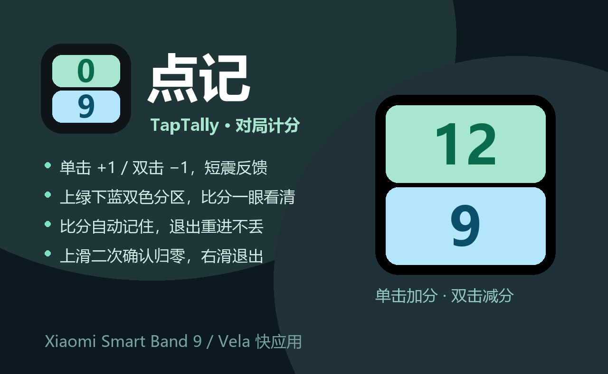

# 点记 TapTally

> 小米手环 9 / 9 NFC 上的**对局计分**快应用（Xiaomi Vela / HyperOS）。
> 台球、乒乓、羽毛球、棋牌……面对面对局时，抬手点一下就能记分。



## 功能

- **上下双色分区**：上方浅绿、下方浅蓝，两位选手的比分一眼分清
- **单击 +1 / 双击 -1**：单击短震一次、双击短震两次，0 分时不会减成负数
- **比分自动保存**：退出应用再进来，比分还在
- **上滑二次确认归零**：清空到 0:0，需要连滑两次，防误触
- **右滑退出**：沿用系统原生返回手势
- **屏幕常亮**：对局中不会黑屏，退出时释放

## 仓库结构

```
src/                    快应用源码（Vela ux 工程）
  manifest.json         快应用清单（包名、权限、路由）
  app.ux                应用生命周期（屏幕常亮）
  pages/index/index.ux  唯一页面：布局 + 交互 + 持久化
  common/logo.png       应用图标（100×100）
package.json            构建脚本与工具链依赖
publish/                资源社区发布物料与操作说明
docs/                   使用说明
manifest.json           ← 资源社区条目元数据（不是快应用清单）
logo-100.png            ← 资源社区图标
cover.png               ← 资源社区宣传图
com.taptally.scoreboard.release.1.0.0.rpk  ← 当前发布包
```

> 注意：根目录的 `manifest.json` 是** AstroBox 资源社区的条目元数据**，快应用真正的清单在 `src/manifest.json`，两者不要混。

## 构建

```bash
pnpm install --registry=https://registry.npmjs.org
node node_modules/aiot-toolkit/lib/bin.js build --enable-jsc
```

产物：`dist/com.taptally.scoreboard.debug.<versionName>.rpk`

- 必须带 `--enable-jsc`：手环运行的是 `.jsc` 字节码，直接手写 zip 或用手机版快应用结构打包，装上去会**重启手环**。
- `aiot release`（production）需要自备 `sign/private.pem` + `sign/certificate.pem`；没有生产证书时只能用 development 模式的调试签名。

## 安装

1. 打开 [AstroBox](https://astrobox.online)，用 BLE 连接手环；
2. 「设备 → 安装队列」选择 `com.taptally.scoreboard.debug.*.rpk`；
3. 首次安装或换了包名后，旧版本请先在「第三方应用管理」里卸载。

## 设备信息

| 项 | 值 |
| --- | --- |
| 目标设备 | 小米手环 9 / 9 NFC（代号 `n66` / `xmb9`，屏幕 192×490） |
| 包名 | `com.taptally.scoreboard` |
| 存储 key | `taptally_v1` |
| 工具链 | aiot-toolkit 2.0.5 + @aiot-toolkit/jsc |

## 许可

[MIT](LICENSE)
